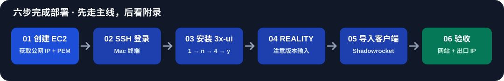
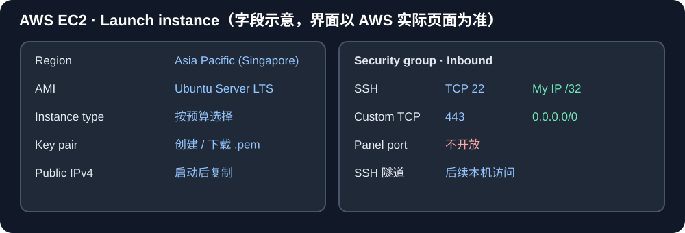
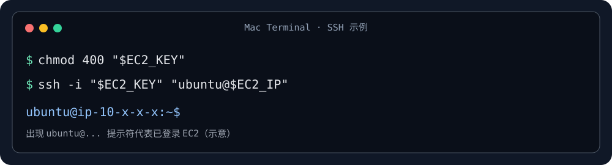
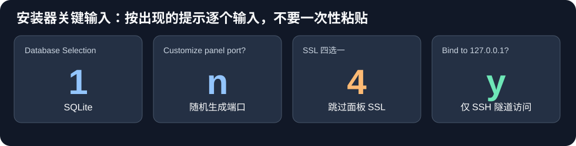
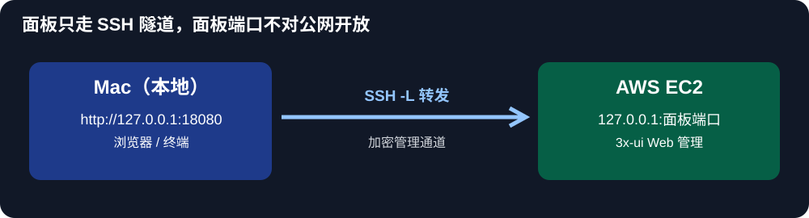
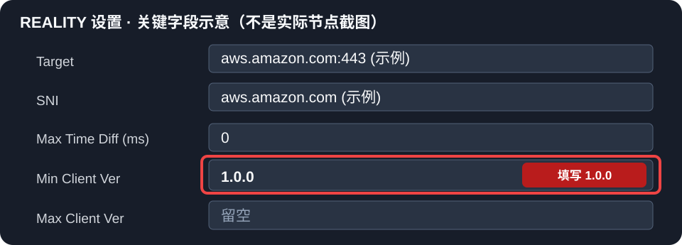
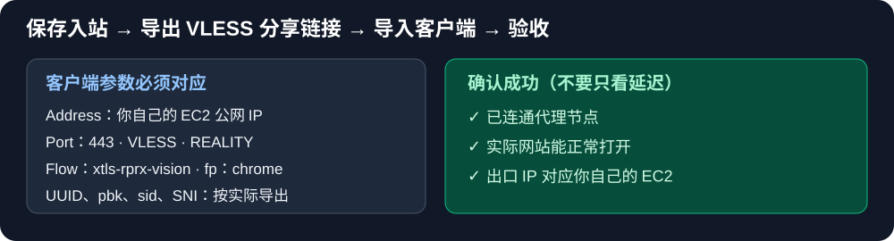

# AWS EC2 + 3x-ui + VLESS / REALITY｜零基础图文部署教程

**Mac + iPhone / Shadowrocket 实操版** · 2026-10-23 更新 · [遇到问题？打开故障排查](troubleshooting.md)

> **适合谁？** 第一次接触 AWS、Linux、SSH 的人。本教程按 **Singapore（SG）节点的成功配置**编排，也可以在 Oregon 使用相同部署步骤；但两地历史验证的 Xray-core 版本不同。
>
> **你能得到什么？** 在自己的 AWS EC2 上搭建 VLESS + REALITY + XTLS Vision 节点，让 Shadowrocket 等兼容客户端连接，并学会安全地通过 SSH 隧道管理面板。
>
> **开始前必须知道**：AWS EC2、IPv4 和出站流量可能收费；你需要自己的 AWS 账号、Mac 终端、一款支持 REALITY 的客户端。全程**不要把 PEM 私钥、UUID、REALITY 私钥、Short ID、面板凭据和完整节点链接提交到 GitHub**。

**阅读方式：从第 1 步顺着做到第 6 步即可。每一步都有“复制什么 / 填什么 / 怎样确认成功”。** 所有深度说明、Oregon 回退经验、故障日志集中在 [故障排查附录](troubleshooting.md)，第一次安装时可以不看。

## 安装前：准备清单

- [ ] 可登录 [AWS EC2 控制台](https://console.aws.amazon.com/ec2/home) 的 AWS 账号
- [ ] 一台 Mac（使用自带的「终端」App）；教程命令按 macOS + Ubuntu 写
- [ ] 准备使用 AWS Singapore Region 的 Linux EC2（或新建一个）
- [ ] 一台 iPhone，安装支持 VLESS + REALITY 的客户端（例如 Shadowrocket）
- [ ] 已了解 AWS 账单/用量控制；**不保证你的账号免费**

**本文中的值有两种：**

| 类型 | 例子 | 要怎么做 |
| --- | --- | --- |
| **需要自己替换** | EC2 公网 IP、`aws-ec2.pem` 文件名、面板随机端口、随机路径、UUID、密钥 | 使用**你自己的实际值** |
| **本次可照填的示例配置** | TCP 443、VLESS、REALITY、`xtls-rprx-vision`、`Min Client Ver = 1.0.0` | 按本文操作；目标域名仍需通过实际扫描/连接测试确认 |

---

## 第 1 步｜在 AWS 创建 EC2

1. 进入 [AWS EC2 控制台](https://console.aws.amazon.com/ec2/home)，右上角选择 **Asia Pacific (Singapore)**（若要 Oregon，选择 **US West (Oregon)**）。
2. 点击 **Instances（实例）→ Launch instances（启动实例）**。
3. 在 **Name** 输入 `sg-vless`（名称可自定义）。
4. 在 **Application and OS Images / AMI** 选择 **Ubuntu Server LTS**（22.04 / 24.04 等兼容版本）。
5. 在 **Instance type** 选预算内合适的规格；不要默认所有实例都在 AWS 免费套餐内。
6. 在 **Key pair** 新建或选择密钥对。新建时选 PEM 格式，下载并保存到 Mac 的 `Downloads`。本文以文件名 `aws-ec2.pem` 为例。
7. 在 **Network settings / 网络设置** 中确认实例位于具有互联网路由的公网子网，**Auto-assign public IP（自动分配公有 IPv4）**已启用；如果你使用自建 VPC/子网，还需检查路由表和 Internet Gateway。然后配置 **Security Group** 的入站规则，确保有下表两条规则：

| 入站类型 | 协议 / 端口 | 来源 | 用途 |
| --- | --- | --- | --- |
| SSH | TCP **22** | **My IP**（自己的当前公网 IP /32） | 通过 Mac 管理 |
| Custom TCP | TCP **443** | **0.0.0.0/0** | 客户端连接 VLESS/REALITY |
| **3x-ui 面板端口** | **不要加规则** | — | 通过 SSH 隧道访问，不开放公网 |

**无需为了本教程开放 TCP 80**：后续选择跳过面板 SSL，面板仅在本机监听。若使用 IPv6、UFW 或额外防火墙，需要分别配置和检查。本教程不要求配置域名。

8. 点击 **Launch instance**，看到实例进入 **Running（运行中）**。
9. 进入该实例详情页，复制 **Public IPv4 address（公网 IPv4 地址）**。**不要复制 Private IPv4**。

**✅ 这一步成功的标志：** 你已经得到 **一个正在运行的 Ubuntu EC2 + 一个 PEM 文件 + 当前公网 IP**。

---

## 第 2 步｜Mac 终端登录 EC2，准备 Ubuntu 环境（尚未安装 VLESS）

打开 Mac 自带「终端」，先复制下面两行，并**改成你自己的 IP 和密钥文件名**：

~~~bash
export EC2_IP='在这里填入你的EC2公网IPv4'
export EC2_KEY="$HOME/Downloads/aws-ec2.pem"
~~~

> `EC2_IP` 的值不是域名样例，不是私网 IP；应是你在 AWS 实例详情页复制的公网 IPv4。如果你的 PEM 文件不叫 `aws-ec2.pem`，请修改第二行的文件名。

接着复制并执行：

~~~bash
chmod 400 "$EC2_KEY"
ssh -i "$EC2_KEY" "ubuntu@$EC2_IP"
~~~

如果第一次出现：

~~~text
Are you sure you want to continue connecting (yes/no/[fingerprint])?
~~~

先核对自己确实连接的是目标 EC2 主机，确认后键入 `yes` 回车。

登录 EC2 成功后，看到类似 `ubuntu@ip-10-xx-xx-xx:~$` 的提示符。**从这一步开始，你输入的命令是在 EC2 服务器上运行，而不是在 Mac 上运行。**

**以下三条命令只是在准备 Ubuntu 环境，还没有安装 VLESS：** `sudo -i` 切换管理员身份、`apt update` 刷新软件包索引、`apt install` 安装 curl 下载工具及 CA 根证书组件。

继续逐条复制：

~~~bash
sudo -i
apt update
apt install -y curl ca-certificates
~~~

> **不要把本步骤误认为 VLESS 已安装。** 下一步才会安装 3x-ui 面板及 Xray-core；第 5 步还需在面板内新增、启用 VLESS + REALITY 入站，才能让客户端实际连接。

检查 443 是否已被其他软件占用：

~~~bash
ss -lntp | grep ':443' || true
~~~

如果输出显示其他服务占用了 443，应先定位原因；不要强行覆盖现有服务。

**✅ 这一步成功的标志：** 终端已进入 EC2 的 Ubuntu/root Shell，且 `apt` 命令完成。

---

## 第 3 步｜真正安装 3x-ui + Xray-core：四次关键输入

本文复现使用过的 **3x-ui v3.8.5** 安装流程。首次全新部署可在 **EC2 Shell** 执行下面的官方项目安装命令：

~~~bash
bash <(curl -Ls https://raw.githubusercontent.com/mhsanaei/3x-ui/v3.8.5/install.sh) v3.8.5
~~~

[3x-ui 官方仓库](https://github.com/MHSanaei/3x-ui) · [v3.8.5 发布记录](https://github.com/MHSanaei/3x-ui/releases/tag/v3.8.5)

> 此命令会获取并执行第三方项目脚本，使用前应信任并核对官方项目来源。**这一步只针对新装实例；SG1 等已在使用的节点不要再次照着重装。** v3.8.5 是我们历史部署的固定复现版本，不等于未来始终最安全/最新的版本；更新前先备份并核验兼容性。

> **安装输入速记：1 → n → 4 → y。** 对应 SQLite → 随机面板端口 → Skip SSL → 限制面板 localhost。每遇到一个提示才输入一个值。

**严格按照屏幕上逐个出现的提问输入。不要一口气粘贴 `1 n 4 y`。**

| 安装器提问（英文关键词） | 你输入 | 为什么 |
| --- | --- | --- |
| `Database Selection`：1) SQLite / 2) PostgreSQL | **`1`** | 单机使用 SQLite |
| `Customize the Panel Port settings?` | **`n`** | 安装器自动生成随机管理端口 |
| `Choose SSL certificate setup method` | **`4`** | 四选一中第 4 项：`Skip SSL` |
| `Bind the panel to 127.0.0.1 only?` | **`y`** | 仅允许本机监听，后续走 SSH 隧道 |

其中 **SSL 四选一** 的完整含义：

~~~text
1. Let's Encrypt for Domain
2. Let's Encrypt for IP Address
3. Custom SSL Certificate
4. Skip SSL (advanced — behind reverse proxy / SSH tunnel only)

请输入：4
~~~

**注意：`4` 是“跳过面板 HTTPS 证书”，不是关闭 REALITY 安全层。** 只有后面选择 `y` 限制面板只监听 `127.0.0.1`，并且**不在 EC2 安全组开放面板端口**时，这套 SSH 隧道方案才合理。

安装结束时，请把以下信息存放到自己的密码管理器或安全笔记中：

~~~text
面板账号：      （安装器输出）
面板密码：      （安装器输出）
面板端口：      （安装器随机生成，例如 28xxx；这里不是实际端口）
随机访问路径：  （安装器随机生成）
~~~

**✅ 这一步成功的标志：** 安装器提示成功，能够看到/记录 4 项管理信息。

---

## 第 4 步｜打开 3x-ui 面板：必须用 SSH 隧道

**重点：回到 Mac，另开一个终端窗口。不要在原来的 EC2 root Shell 执行这一段。**

在**新开的 Mac 终端**，重新设置变量（因为新窗口不会继承旧窗口变量）：

~~~bash
export EC2_IP='在这里填入你的EC2公网IPv4'
export EC2_KEY="$HOME/Downloads/aws-ec2.pem"
export PANEL_PORT='在这里填入安装器输出的面板端口'
~~~

三处值都换成你自己的真实值后，复制：

~~~bash
ssh -i "$EC2_KEY" \
  -o ServerAliveInterval=30 \
  -o ExitOnForwardFailure=yes \
  -N -L "18080:127.0.0.1:$PANEL_PORT" \
  "ubuntu@$EC2_IP"
~~~

**执行后终端没有继续打印文字、也不返回命令提示符，通常是正常的**：它正在保持 SSH 隧道，**不要关闭这个窗口**。

在 Mac 浏览器地址栏输入：

~~~text
http://127.0.0.1:18080/你的随机访问路径/
~~~

把 `你的随机访问路径` 换成安装器输出的实际路径，末尾斜杠按安装器给出的真实 URL 保留。输入安装器生成的**面板账号/密码**登录。

> **别混淆三个端口：** `22` 是 EC2 SSH 管理；`443` 是 VLESS/REALITY 代理；`18080` 是 Mac 本地临时入口。还有一个安装器随机生成的 **EC2 面板端口**，只通过 SSH 隧道连接，**不需要公网放行**。

**✅ 这一步成功的标志：** Mac 浏览器能通过 `127.0.0.1:18080` 登录 3x-ui 面板。

---

## 第 5 步｜配置 VLESS + REALITY：照表填写

在面板中进入 **Inbounds（入站列表）→ Add Inbound（添加入站）**。先填写主配置：

| 3x-ui 字段 | 本教程输入 |
| --- | --- |
| Remark | `AWS-SG-Reality`（可自定义） |
| Enable | 开启 |
| Protocol | **VLESS** |
| Port | **`443`** |
| Listen IP | 保持默认全接口，不要填 `127.0.0.1` |
| Clients | 添加客户端，并生成自己的 UUID |
| Flow | **`xtls-rprx-vision`** |
| Transport / Network | **TCP / RAW** |
| Security | **REALITY** |
| Fingerprint（客户端） | **`chrome`** |

### 5.1 REALITY 内的关键参数（不要漏掉）

请向下滚动到 REALITY 参数区域。以下 **Target/SNI 只是格式示例**，使用之前应通过面板的 **Scan / Find Targets** 及实际握手测试确认该目标可用。目标可能因网络、TLS 条件变化而不可用；**不要机械复制未验证的域名**。

| 字段 | 具体填写或操作 | 小白提醒 |
| --- | --- | --- |
| Target | `aws.amazon.com:443`（示例） | 不是你的 EC2 IP |
| Server Names / SNI | `aws.amazon.com`（示例） | 必须与目标握手兼容；客户端同样使用此 SNI |
| Max Time Diff (ms) | `0` | 按本次使用示例 |
| **Min Client Ver** | **`1.0.0`** | **必须按本次实操填写，不要留空** |
| Max Client Ver | 留空 | 不要把 `1.0.0` 错填到这里 |
| Xver | `0` | 按本次示例 |
| Private/Public Key | 点击 **Generate / 生成密钥对** | 私钥留在服务端；客户端用公钥 |
| Short IDs | 点击 **Generate / 随机生成** | 导入客户端时要匹配其中一个合法 Short ID |
| SpiderX | `/` | 如客户端有该字段，按服务端配置 |

**⚠️ 我们实际踩过的坑：`Min Client Ver` 不填写时，出现过客户端连不通；填写 `1.0.0` 后使用正常。** 这条是对本次历史成功配置的复现要求，不代表所有版本的 REALITY 都一定要求非空。字段表示**允许的最低客户端版本**，并非 3x-ui 面板版本，更不是强制安装 Xray 1.0.0。

确认字段后**保存入站并启用**。如果入站有错误提示，不要跳过；先核对 443 是否被占用、目标/SNI 是否兼容、Flow 与 REALITY 参数是否配对。

**✅ 这一步成功的标志：** 3x-ui 入站显示已启用、Xray 正常运行，EC2 中可以检查：

~~~bash
sudo x-ui status
sudo ss -lntp | grep ':443'
~~~

*注意：这两条命令须在 EC2 终端执行；如果当前在 Mac 终端，应先 SSH 登录 EC2 再运行。*

---

## 第 6 步｜导入 Shadowrocket 并验收

1. 在 3x-ui 入站列表里找到刚创建的 **VLESS 客户端**，使用面板的分享/导出功能取得**你的专属节点链接或二维码**。
2. 在 iPhone 的 Shadowrocket 中使用对应导入方式。**不要把分享链接或二维码发到公开群/论坛/GitHub。**
3. 选择新节点，打开连接，再访问实际网页进行验收。

如果客户端已经导入却无法连通，进入客户端详情，优先核对：

| 客户端字段 | 应该是什么 |
| --- | --- |
| Address / Server | **你的 EC2 公网 IP**（绝不是 `127.0.0.1`） |
| Port | `443` |
| Type | VLESS |
| Security | REALITY |
| UUID / ID | 与面板该客户端一致 |
| Flow | `xtls-rprx-vision` |
| Transport | TCP / RAW |
| SNI | 与 REALITY 设置中选定的 SNI 一致 |
| Public Key / pbk | **REALITY 公钥**，不是私钥 |
| Short ID / sid | 服务端已生成的其中一个匹配值 |
| Fingerprint | `chrome` |

**最终验收清单：**

- [ ] 面板正常登录，入站已启用
- [ ] EC2 服务器确实在 TCP **443** 监听
- [ ] Shadowrocket 已连接新导入的节点
- [ ] 通过代理可以实际打开常用 HTTPS 网站，而不只是“延迟测试通过”
- [ ] 通过代理访问 [api.ipify.org](https://api.ipify.org) 等公网 IP 查询服务时，显示的出口是自己的 EC2（注意客户端分流规则可能影响结果）
- [ ] 关闭 Mac 面板 SSH 隧道后，**客户端代理仍可正常使用**（面板管理通道和代理入站彼此独立）

**至此部署完成。** 请把 EC2 IP、账号等信息只放在安全的私人位置，**不要把服务器配置备份提交到本仓库**。

---

## 常见问题与版本说明

**Q：两地部署是不是完全一样？** 创建 EC2、安装面板、443 入站、REALITY、客户端导入步骤基本相同；但旧记录中 SG 的 Xray-core **26.9.9** 已实测正常，Oregon 曾需回退到 **26.6.27**。版本属于不同节点的历史验证结果，**不要对正在使用的 SG 主动照搬 Oregon 的降级操作**。详情见 [附录](troubleshooting.md)。

**Q：面板打不开怎么办？** 先查 SSH 隧道的远端端口、Mac `18080`、随机访问路径是否正确。不要为图方便把面板 HTTP 端口开放到公网。

**Q：`Min Client Ver = 1.0.0` 是 3x-ui 的版本吗？** 不是，它是 REALITY 的最低客户端版本字段；本次历史配置明确填写了这一项。

**Q：有没有真正的一键全自动安装？** 本文是**可复制的交互式逐步安装教程**，不是无人值守的全自动脚本。AWS 账号、EC2 创建、密钥保存、敏感参数生成和客户端导入仍需用户自己操作，以免不明脚本管理云账号或暴露秘钥。

**Q：安全组和面板是否要共用端口？** 不要。AWS 安全组公网入站开放 SSH 22（仅自己 IP）及代理 443；面板保持 localhost，仅由 SSH 隧道管理。

**Q：怎么处理连不通、热点异常、Oregon 回退？** 打开 [详细故障排查与历史验证记录](troubleshooting.md)。

## 项目维护说明

- 本教程根据 2026 年 8—9 月 SG/Oregon 实际部署流程、历史排障以及 2026-10-23 的反馈整理，并**不代表对现有 SG 服务器进行了实时登录检查**。
- 文中的 AWS/终端/REALITY 插图是**脱敏的字段或流程示意图，并非逐屏真实截图**；AWS 控制台或 3x-ui 未来可能调整布局。
- 3x-ui 原项目与安装器版权归其贡献者所有：[MHSanaei/3x-ui](https://github.com/MHSanaei/3x-ui)。
- 若有新的 3x-ui/Xray 版本差异，建议先在**新节点**测试，通过实际网站与出口验收后再更新主用节点。
- 如发现错误，欢迎通过 GitHub Issue 提交**不含密钥和完整分享链接**的复现步骤。

---

⭐ **如果这份教程帮助你完成了部署，欢迎点击本仓库右上角的 Star 支持一下，让更多新手找到这份指南。** 感谢每一次有依据的补充和纠错。
